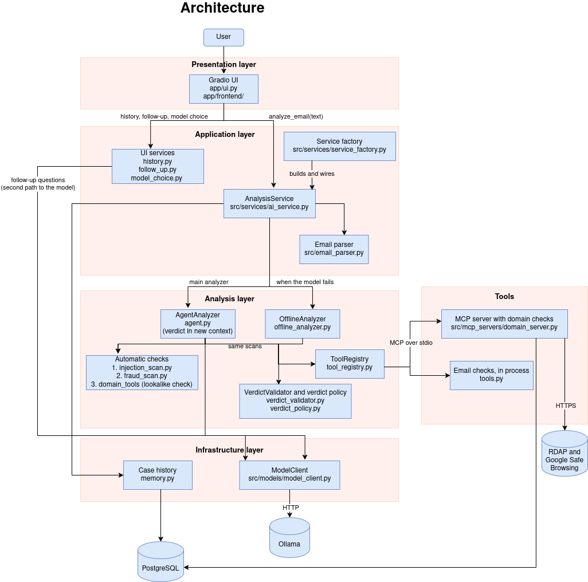

# SpotThePhish

Group project for the Development of AI Applications course (Autumn 2026).

SpotThePhish is a local AI assistant that checks a single email for phishing. It explains its verdict with evidence that the application has verified, so the user can see why an email is dangerous instead of getting a bare yes or no.

## Quick start

You need Conda, Ollama and Docker. The full steps with explanations are in [Setup](#setup).

```bash
conda env create -f environment.yml  
conda activate dev-ai-project
cp .env.example .env 
ollama pull qwen2.5:3b 
docker compose up -d  

python -m app.main
```

## Team members

- Elif Akpinar (amk1020345@student.hamk.fi)
- Jaiesh Badireddy (amk1020036@student.hamk.fi)
- Riana Debre (amk1020017@student.hamk.fi)
- Martina Spiegel (amk1020344@student.hamk.fi)

## Problem

### Intended users

#### University Staff Members
Administrative staff, lecturers, researchers and other university employees regularly receive emails involving student information, accounts, invoices, documents and external organisations.
Keeping this information safe from phishing is essential. These users may notice that an email looks unusual, but they often lack the technical knowledge to inspect it more closely.

#### Students
Students regularly receive messages about account access, passwords, payments and other university services, which makes them frequent targets of phishing attacks.
They are responsible for their own accounts rather than for the organisation, but a compromised student account can still be used to attack others.

#### Employees
Employees who handle business email often have no technical expertise.
In smaller organisations without a security team, they have to judge suspicious emails themselves.
A successful phishing attack can expose credentials, financial information or customer data.

#### IT Support
IT support staff receive reports of suspicious emails from users.
Instead of inspecting every reported email from scratch, they can use SpotThePhish to obtain a first assessment with supporting evidence.

### Problem statement
Phishing is one of the most common entry points for cyber attacks.
It works because the final decision is made by a person who cannot see the technical warning signs.
Phishing messages imitate organisations, manipulate users and steal sensitive information using techniques such as deceptive hyperlinks, domain impersonation and malicious attachments.

The information needed to judge an email is spread across places that users rarely look at:

- SPF, DKIM and DMARC authentication results
- inconsistencies between the From, Reply-To and Return-Path headers
- differences between the displayed link text and the actual link destination
- lookalike or newly registered domains
- dangerous attachment names and extensions
- external reputation information about links

Conventional email filters run such checks automatically, but they give little or no explanation for their decisions and some phishing messages still get through.
At that point, a person has to make the decision.

SpotThePhish addresses this with an interactive, evidence-based analysis of a single email.
Instead of a bare binary classification, it identifies the relevant technical and linguistic indicators and derives a recommendation from them.

### Why AI is appropriate
Phishing analysis combines technical and linguistic analysis.
SpotThePhish therefore combines an LLM with deterministic processing instead of relying on the language model alone.

#### Email analysis stays deterministic
Attributes such as From, Reply-To, Subject, links, attachments and authentication results are extracted into a defined data schema and analysed with deterministic code.
For example, From and Reply-To can be compared directly, links can be inspected for hidden targets and domains can be checked against a brand list, RDAP or earlier verdicts.
These results are facts, not guesses.

#### Adaptive analysis
Different emails require different checks.
A message with a suspicious link needs link and domain analysis, while an urgent payment request needs sender and authentication analysis.
The model looks at the email and the results so far and decides which checks are relevant, so not every check has to run on every email.

#### Language and interpretation
Phishing relies on social engineering such as urgency, authority, threats and requests for credentials or payment.
These patterns are phrased differently in every email and cannot be captured reliably with fixed keyword rules, but an LLM can recognise them.
Some scams contain no technical indicator at all, for example a gift card request from a hacked colleague account. Only the language analysis can detect them.
The LLM also combines the technical findings with its language analysis and explains the result in plain language, because raw security results are not understandable to non-specialist users.

## Solution

SpotThePhish is a local web application in which the user pastes an email or uploads an `.eml` file. An investigation agent analyses the email, decides which security checks to run, observes the results and stops when it has enough evidence.
The application then returns:

- a verdict: phishing, suspicious or likely safe
- a risk score from 0 to 100
- a list of evidence items, each linked to the check that produced it or to an exact quote from the email
- a plain-language explanation and a recommended action
- warnings, for example when a check could not run or the email had no headers
- the full investigation trace, showing which checks were run and why

The model proposes the next action and the final assessment.
The application code controls which tools exist, validates every tool call, limits the number of steps, checks every piece of evidence and applies safety rules that the model cannot override.

### Scope

**In scope**
- Analysis of a single email (pasted raw text or `.eml` upload), mainly in English.
- Read-only security checks. No links are opened in a browser and no attachments are executed.
- Explained verdict with evidence and investigation trace.
- Detection of prompt injection, meaning text inside the email that tries to instruct the AI.
- Evaluation on a public labelled dataset and on hand-crafted test emails.

**Out of scope**
- Mailbox integration or automatic actions such as deleting, blocking or reporting emails.
- Visiting live phishing pages or scanning attachment contents for malware.
- Replacing enterprise email filters. SpotThePhish is a second-opinion assistant for the moment a user is unsure.

## Main user workflow

1. **User input:** The user pastes an email or uploads an `.eml` file in the Gradio interface.
2. **Validation and parsing:** The service layer (`src/services/ai_service.py`) rejects empty or oversized input before any model call. The email parser then extracts sender, reply-to, return-path, authentication results, subject, body text, links and attachment metadata. Text pasted without headers is analysed as a message body, with a warning that the sender cannot be verified.
3. **Automatic scans:** Before the model sees the email, two deterministic scans run. The prompt injection scan looks for instructions aimed at AI tools, also in hidden HTML. The payment fraud scan looks for requests for gift cards, money, bank details or codes combined with urgency or secrecy, which technical checks cannot see when a real account was hacked. Their results are always observations 1 and 2.
4. **Investigation loop:** The model (called through the model client and Ollama) receives the parsed email as untrusted data and selects the next check from the allowed tools. The application validates the request, executes the tool and adds the result as a numbered observation. This repeats until the model finishes or the budget of 6 steps is used up.
5. **Verdict validation:** The model's final report must match a fixed schema. Every evidence item must cite a check that actually ran or quote the email word for word. Deterministic rules then enforce minimum risk levels, for example a link listed as malicious by the reputation service always results in phishing.
6. **Result:** The UI shows the verdict, risk score, evidence, explanation, recommendation, warnings and investigation trace. A fingerprint of the validated verdict is stored in the case history.

If the model fails (Ollama not running, model not installed, timeout or output that stays invalid after one correction), the application switches to an offline analysis. It runs every check that needs neither the model nor the network and shows a rule-based result that is clearly labelled as a fallback.

## Architecture

The full description with diagrams is in [`docs/architecture.md`](docs/architecture.md). The reasons behind each design choice are in [`docs/project-decisions.md`](docs/project-decisions.md).



```text
User
  ↓ paste email / upload .eml
Gradio UI (app/ui.py)
  ↓ analyze_email(text) -> verdict, evidence, explanation, warnings, investigation trace
Application Service (src/services/ai_service.py)
  | → Email Parser (src/email_parser.py): deterministic parsing
  | → Investigation Agent (src/capabilities/agent.py): model chooses checks, max 6 steps
  |    → Prompt Injection Scan (src/capabilities/injection_scan.py): always observation 1
  |    → Payment Fraud Scan (src/capabilities/fraud_scan.py): always observation 2
  |    → Tool Registry (src/capabilities/tool_registry.py): validates every tool call
  |       - email checks, in-process (src/capabilities/tools.py):
  |           check_email_authentication, analyze_links, inspect_attachments
  |       - domain checks, via MCP server (src/mcp_servers/domain_server.py):
  |           check_lookalike_domain, check_domain_age, check_url_reputation, lookup_case_history
  |    → Verdict Validator (src/capabilities/verdict_validator.py): evidence grounding
  |    → Verdict Policy (src/capabilities/verdict_policy.py): score bands, safety rules
  |    → Model Client (src/models/model_client.py) → Ollama (local) → qwen2.5:3b
  | → Offline Fallback (src/capabilities/offline_analyzer.py): used when the model fails
  | → Case History (src/capabilities/memory.py): PostgreSQL, fingerprints only
  ↑ all objects are created and connected in src/services/service_factory.py
```

> **Core Architectural Rule:** The user interface must NEVER communicate directly with the model client or Ollama. All interactions must pass through the service layer (`ai_service.py`).

- **UI isolation:** The UI only calls the service layer, which handles orchestration.
- **The application owns execution:** The model can only propose actions from a fixed list of read-only tools. Arguments are validated before execution, and a domain or link may only be checked if it appears in the email. Invalid requests are rejected and reported back to the model as an observation.
- **Email content is untrusted data:** Emails are passed to the model in data blocks with a random boundary per run, so an email cannot close its own block. Instructions inside an email are treated as a phishing signal, not as instructions.
- **Verified evidence only:** The user only sees evidence that points to a real check or to text that is really in the email.
- **Safe by design:** No tool opens a URL in a browser, downloads a page or executes an attachment.
- **Graceful degradation:** If an API key is missing or a service is down, the tool returns "unavailable", the agent continues with the remaining evidence and the UI states which checks could not be run. If the model is not available, the offline fallback takes over.

## Model

- **Model used:** `qwen2.5:3b`, running locally through Ollama. `qwen3:8b` can be used instead by changing `MODEL_NAME`, without any code change.
- **Why the 3B model:** We started with `qwen3:8b`. On our laptops without a graphics card, one analysis took around 3 minutes, which is too long for a user who wants to know whether to click a link. `qwen2.5:3b` needs about 60 seconds. Because the application checks every decision, every piece of evidence and every verdict itself, a smaller model has less room to make dangerous mistakes. The larger model judges difficult emails better, as our evaluation shows, so the choice is a trade-off between speed and accuracy.
- **Selection rationale:**
  - **Privacy:** Emails may contain personal and confidential data. Running the model locally through Ollama keeps the email and its analysis on the user's machine instead of sending them to a third-party LLM API.
  - **Structured output:** The agent loop depends on reliable JSON decisions and a schema-conformant final report. Qwen3 supports structured output in Ollama, and the schema even limits the model to the real tool names.
  - **Small and fast:** The 3B model runs on a normal laptop with 8 GB RAM and answers fast enough for an interactive tool. The facts come from the tools, so the model mainly has to choose checks, read the language of the email and explain the result.
  - **Configurability:** The model is set through environment variables, so `qwen2.5:3b` and `qwen3:8b` can be compared without changing the application.
- **Evaluation result:** with the same code, `qwen3:8b` passed 9 of our 10 test emails without a false alarm, `qwen2.5:3b` only 6 of 10. The 8B model took about three minutes per email on our laptops instead of one to two. We therefore keep the 3B model as the default for laptops without a graphics card and recommend `qwen3:8b` whenever the hardware allows it (see [`evaluation/evaluation_results.md`](evaluation/evaluation_results.md)).
- **Settings:** temperature 0 for repeatable results, thinking mode off when a Qwen3 model is used (Qwen2.5 has none), a context window of 8192 tokens and a timeout of 300 seconds per call. All settings can be changed in `.env` (see Decision 9).

## Additional AI capability

- [ ] RAG (Retrieval-Augmented Generation)
- [x] Tools / External API integration
- [x] Model Context Protocol (MCP)
- [x] Agentic workflow (Model-selected actions based on observations)
- [x] Memory / Persistent state
- [ ] Multimodal interaction (Text + Images)
- [ ] Other: ______________________

### Capability justification

#### Tools
An LLM alone cannot know whether a domain was registered yesterday, whether DKIM verification failed or whether a URL is on a blocklist. It would guess, and a guessed security verdict is dangerous.
The tools provide verifiable facts, and the model's job is to interpret and explain them.
SpotThePhish has seven read-only tools. Three of them check the email itself (authentication, links, attachments). Four of them check domains and history (lookalike domains, domain age via RDAP, link reputation via Google Safe Browsing, case history).

#### Agent
Phishing emails attack in different ways. Some rely on a malicious link, some on a fake sender identity and some on a dangerous attachment.
Which checks are useful therefore cannot be decided in advance:

- **The relevant checks depend on the email.** Link checks are pointless for an email without links and attachment checks are pointless without attachments.
- **Each result changes what to check next.** A suspicious finding calls for a deeper check, while a clear finding makes further checks unnecessary.

A fixed workflow would run every check on every email. This is slower, sends more data to external services and fills the explanation with irrelevant findings. The agent selects only the relevant checks and stops as soon as the evidence is clear. The application code still decides which tools are allowed, limits the number of steps and applies the final safety rules.

The evaluation tests this claim by comparing the agent with a fixed pipeline and an LLM-only baseline (see [Evaluation](#evaluation)).

#### Model Context Protocol (MCP)
The four domain and memory tools depend on external systems (RDAP, a reputation service, a database), so they are exposed through an MCP server. The application starts the server once, discovers the tools via `list_tools()` and calls them through an MCP client. The email-analysis tools have no external dependency and stay direct in-process tools. The application still validates every call, and writing to the case history is not an MCP tool, so the model can only read it. See [Decision 4](docs/project-decisions.md).

#### Memory / persistent state
Phishing arrives in campaigns. SpotThePhish stores a fingerprint of every validated verdict in PostgreSQL (sender domain, link domains, a hash of the normalised subject, verdict, risk score, date) and never the email body.
The agent can query it with the `lookup_case_history` tool. If the same sender domain, link domain or subject pattern was already judged phishing, the result tells the user that this is a known campaign.
The subject is normalised before hashing, so "Parcel 8841 could not be delivered" and "RE: Parcel 5530 could not be delivered" are recognised as the same campaign.
A previous verdict is treated as evidence, not as an automatic answer, so a wrong earlier result cannot silently repeat itself. Fallback verdicts are not stored. See [Decision 5](docs/project-decisions.md).

#### Why not RAG
The needed knowledge is not in a document collection. It comes from the email itself and from live checks, so tools are the appropriate capability.

## Setup

### 1. Create the Conda environment

```bash
conda env create -f environment.yml
```

Without Conda, create a virtual environment with Python 3.12 and install the same packages with `pip install -r requirements.txt`. Then skip step 2.

### 2. Activate the environment

```bash
conda activate dev-ai-project
```

### 3. Configure environment variables

Copy `.env.example` to create your local `.env` configuration file:

On Linux / macOS:
```bash
cp .env.example .env
```

On Windows (Command Prompt / PowerShell):
```powershell
copy .env.example .env
```

Ensure `.env` contains valid values for `OLLAMA_BASE_URL` and `MODEL_NAME`:
```env
OLLAMA_BASE_URL=http://localhost:11434
MODEL_NAME=qwen2.5:3b
```

Never commit `.env`. It is already excluded by `.gitignore`.

### 4. Start Ollama and pull the model

Make sure Ollama is installed and running locally, then pull the model:

```bash
ollama pull qwen2.5:3b
```

To use the larger model, run `ollama pull qwen3:8b` and set `MODEL_NAME=qwen3:8b` in `.env`. It needs about 16 GB RAM and is about three times slower without a graphics card.

### 5. Start PostgreSQL

The case history and the evaluation cache use PostgreSQL. Start it with Docker from the project root folder:

```bash
docker compose up -d
```

This creates the databases `spotthephish`, `spotthephish_eval` and `spotthephish_test`. If you already had a volume from an older version, run `docker compose down -v` once before starting.

Optional: put your own Google Safe Browsing key into `.env` (`SAFE_BROWSING_API_KEY`) to enable the link reputation check. Without a key the check reports "unavailable" and the analysis continues. Never commit or share the key.

The domain tool server (MCP) is started automatically by the application. You do not need to start it yourself.

### 6. Run the application

Run the application from the root directory of the project:

```bash
python -m app.main
```

Then open your browser at `http://localhost:7860`.

To analyse `.eml` files from the command line without the UI, run:

```bash
python -m scripts.try_agent "evaluation/cases/*.eml"
```

It prints the verdict, evidence, warnings and the full trace for each file.

### 7. Run automated tests

```bash
pytest -rs
```

The tests need neither Ollama nor the network, because the model is replaced by a scripted fake model. Tests that need the database use the separate database from `TEST_DATABASE_URL` (see `.env.example`). If it is not reachable or the variable is missing, those tests are skipped and `-rs` shows the reason.

## Evaluation
The results are in [`evaluation/evaluation_results.md`](evaluation/evaluation_results.md). How to run the evaluation is described in [`evaluation/README.md`](evaluation/README.md).

The evaluation answers three questions:

1. **Does SpotThePhish detect phishing reliably?** Precision, recall, F1 and false positive rate on labelled emails.
2. **Is the agent justified?** Three configurations are compared on the same emails.
3. **Does it behave safely in difficult and failure situations?** Test cases with expected behaviour, recorded as pass, partial or fail.

### Dataset
The evaluation uses two data sources, because each one covers a different part of the application:

| Source | Content | Used to evaluate |
|---|---|---|
| [Phishing validation emails dataset](https://doi.org/10.5281/zenodo.13474746) (Miltchev et al., 2024, CC BY 4.0) | 2,000 short labelled email texts (1,000 phishing, 1,000 legitimate), text only (no headers) | Language-based detection, LLM-only baseline, false positive rate |
| Hand-crafted `.eml` cases in `evaluation/cases` | 28 emails written by the team with full headers, using fictional `.example` domains for every suspicious sender and link | Authentication, link, domain, attachment and campaign checks, prompt injection, difficult and adversarial cases |

The validation dataset contains only email text, so it cannot test header, link or attachment checks. The hand-crafted cases cover these checks.
The evaluation uses a stratified sample of the dataset with a fixed seed, so every run sees the same emails.
Reputation and domain-age results change over time, so the results of the online checks are stored in an evaluation cache and replayed. For the fictional domains they are seeded on purpose (see Decision 8).

Dataset sources and licenses are documented in [`data/README.md`](data/README.md).
Raw datasets with real names and email addresses are kept locally in `data/raw/` and excluded from the repository via `.gitignore`. No real personal emails are committed to the repository.

### Compared configurations

| Configuration | Description |
|---|---|
| LLM-only | The model classifies the email without any tools |
| Fixed pipeline | All tools run on every email, then the model writes the verdict |
| Agent (SpotThePhish) | The model selects the checks step by step and stops when the evidence is clear |

All three use the same prompts, the same verdict validation and the same safety rules, so differences in the results only come from how the evidence is collected.

### Metrics

| Aspect | Measure |
|---|---|
| Detection quality | Precision, recall, F1, false positive rate and accuracy for phishing |
| Efficiency | Average latency, model calls and tool calls per email |
| Reliability | Number of fallbacks and invalid model outputs |
| Evidence grounding | Checked automatically for every evidence item: it must cite a check that ran or quote the email word for word |
| Case history | For the repeated campaign case: whether the earlier verdict is recognised |

A false negative (phishing classified as safe) is the most harmful error, so **recall on phishing is the primary metric**. A suspicious verdict counts as phishing by default, because the user is then warned.

### Test cases

There are 38 behaviour-focused test cases with 33 emails in `evaluation/cases`. Each team member documents their own cases: [`evaluation/martina_test_cases.json`](evaluation/martina_test_cases.json) (emails 01 to 18, domain checks and memory), [`evaluation/elif_test_cases.json`](evaluation/elif_test_cases.json) (emails 19 to 28 and two failure cases, agent and model) and [`evaluation/riana_test_cases.json`](evaluation/riana_test_cases.json) (emails 29 to 33, email checks). They cover three categories:

- **Successful cases:** typical phishing types such as lookalike domains, newly registered domains, fake deliveries, dangerous attachments and phishing in Finnish.
- **Difficult cases:** alarming but legitimate emails (a real password reset, a course email about AI), payment and gift card fraud without technical indicators, emails without headers, very long emails and a repeated campaign.
- **Failure and adversarial cases:** prompt injection in visible text, hidden HTML, quoted replies and fake instruction blocks, a fake security banner, an attempt to waste the step budget, unavailable online services, Ollama not running, invalid model output and empty input.

Each case records the expected behaviour, grading rules, the actual result and a status (pass, partial or fail). Failure cases that cannot be produced with an email, such as invalid model output, are covered by automated tests, which are named in each entry.

## Known limitations

- The phishing validation dataset contains only short texts and is partly artificially generated, so it cannot test header, link or attachment checks, and results on it may not fully reflect real emails.
- The hand-crafted cases were written by the team. They test specific behaviour but are too few for strong statistical claims.
- Emails pasted without headers cannot be checked for authentication results, which weakens the assessment.
- Phishing sent from compromised legitimate accounts passes authentication and domain checks, so detection then depends mainly on the language analysis.
- A small local model (3B) may produce invalid actions or miss subtle manipulation. The validation, step limits and fallback limit the impact, but they do not eliminate errors.
- On a computer without a graphics card, the model runs on the processor. In our evaluation with `qwen2.5:3b`, one analysis took between about 40 seconds and 3 minutes, with a median of 77 to 140 seconds depending on the run.
- The judgement of the 3B model varies between runs and is sensitive to the wording of the prompt. In our evaluation it rated a genuine password reset as phishing in three runs in a row (case-23), and its explanations sometimes contain claims that no check supports. The deterministic checks and safety rules give the same result every time, so we moved the gift card and payment fraud detection into such a check.
- The case history matches on the sender domain. One phishing email from a hacked account of a real organisation can therefore make later genuine emails from that organisation look like a known campaign (case-22). Ignoring the sender domain of well-known domains, as is already done for link domains, would prevent this.
- The model only sees the first 6,000 characters of the body. The link and attachment checks still use the full email, but wording at the end of a very long email is not analysed by the model.
- The prompt injection scan uses patterns for typical phrasings. An instruction without such phrases is not detected by the scan. In that case only the step budget, the argument checks and the safety rules protect the analysis.
- The lookalike check uses a small, hand-maintained list of brand domains. It can miss imitations of other brands and can flag a legitimate domain that merely contains a listed brand name (for example a local shop whose name contains "hamk") or a legitimate subdomain that contains a brand name. Ordinary words that are also brands (`office`, `apple`, `zoom`) only count together with an account word such as `login`. Risk values and thresholds are initial, hand-chosen settings.
- Domain age relies on RDAP. Not every top-level domain publishes RDAP data, so a missing record is only a weak signal, and public RDAP servers can rate-limit requests.
- The URL reputation check needs a Google Safe Browsing API key, which is free only for non-commercial use, and it sends the checked URL to Google. The key is sent in a request header and never logged. A URL that is not listed is not proven safe, and very new phishing pages may not be listed yet.
- Online checks that cannot run (timeout, rate limit, missing key) are reported as "unavailable". They reduce the evidence, but the application does not retry automatically.
- The case history only reflects earlier verdicts and inherits their errors. Matching by subject pattern can produce false matches for generic subjects. Sender domains of well-known organisations and free-mail providers are not matched. Verdicts from the offline fallback are not stored. The subject hash is not salted, and there is no automatic deletion period.
- The MCP server uses the same database user as the application. The model cannot write to the history because no write tool exists, not because of database permissions.
- If the domain tools are unavailable, the model can still answer "likely safe" for a phishing email. The user sees a warning that some checks could not run.
- Evaluation results for online tools come from a cache. They describe the state at recording time, and results for fictional test domains are seeded assumptions that say nothing about the accuracy of the live services.
- The full application needs a running PostgreSQL instance (Docker) for the case history. Without it, only that capability is unavailable.
- The offline fallback runs only checks that need no model and no network. It cannot look up the age of a domain and cannot judge the wording of an email, so a scam without technical indicators can be rated "likely safe" in fallback mode.

## Future improvements

- Browser or mail-client extension for one-click analysis
- Reporting system for IT support
- Organisation-specific allowlists of known senders, built on the case history
- Better support for non-English emails and a larger, regularly updated brand list
- A small trained classifier for prompt injection in addition to the pattern scan

## Presentation video

The link will be added before the final submission (22 October 2026).