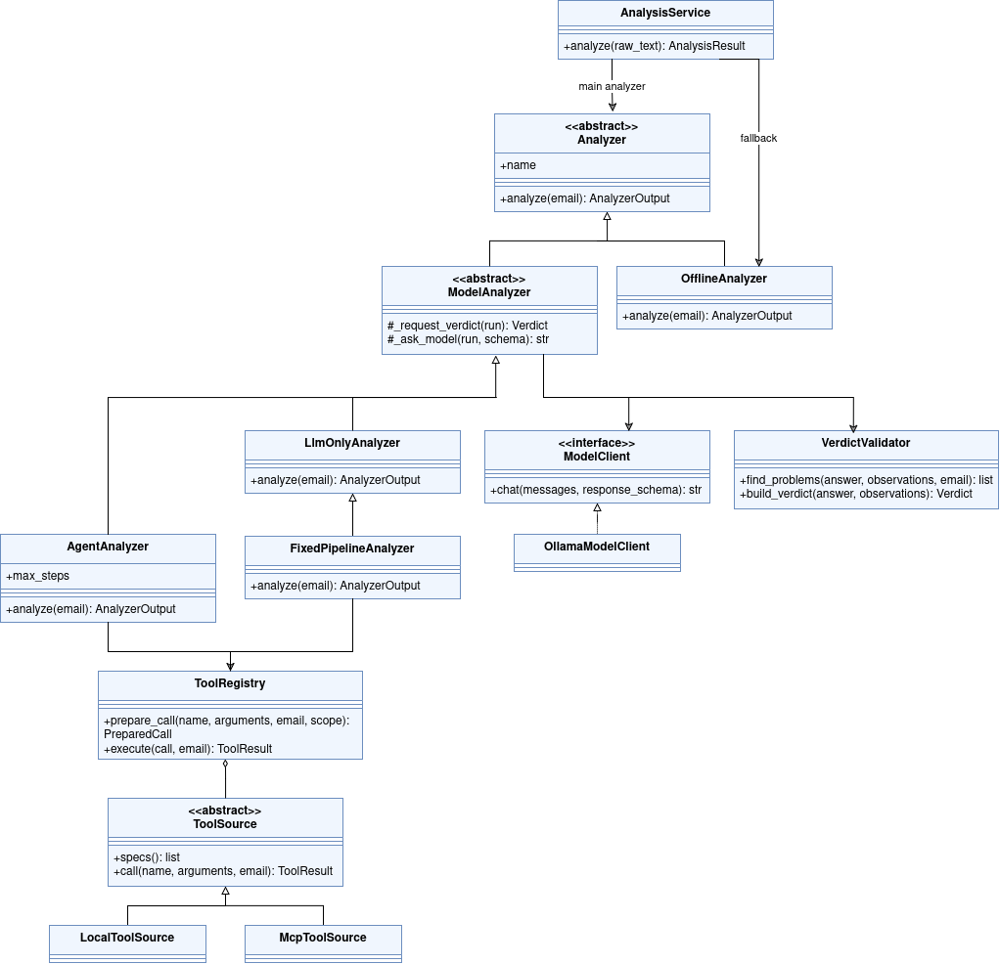
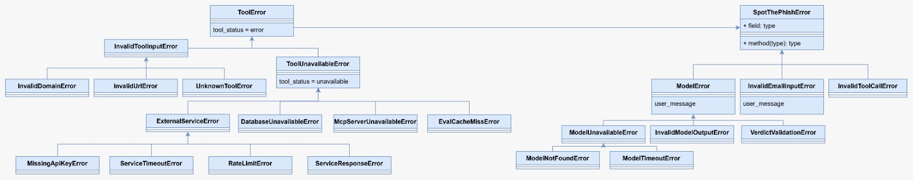

# SpotThePhish — Architecture Documentation

This document explains how SpotThePhish is built. It describes the layers of the application, the path of one email through the system, the agent loop, the most important classes, the runtime environment and the error handling.

## 1. System Overview & Extended Architecture

SpotThePhish extends the course starter template with three integrated AI capabilities:
1. **Agentic Workflow:** The model decides which check to run next, based on the observations so far.
2. **Tool Integration:** Read-only security checks deliver facts about the email, such as authentication results, link targets and domain age.
3. **Memory / Persistent State:** A case history in PostgreSQL stores a small fingerprint of every validated verdict, so that repeated phishing campaigns can be recognised.

The model never acts on its own. It only proposes the next step. The application decides whether that step is allowed, runs it and checks the final answer before the user sees it.

## 2. Layers and components

The application follows the layered architecture from the course. Each layer only talks to the layer below it.

### Presentation layer
The presentation layer is the Gradio interface in app/ui.py. It takes the pasted email or the uploaded .eml file and shows the result. It calls a single function of the service layer, analyze_email, and never talks to the model or to a tool directly.

### Application layer
The application layer contains the AnalysisService in src/services/ai_service.py. It is the single entry point for every analysis. It checks the input, calls the email parser, runs the main analyzer, switches to the offline fallback when the model fails and saves the fingerprint of the verdict. The service factory in src/services/service_factory.py is the composition root. It is the only place where the real objects are created and connected. All other classes receive their collaborators through the constructor. This allows the tests and the evaluation to use the same wiring as the app with a scripted model instead of Ollama.

### Analysis layer
The analysis layer contains the AgentAnalyzer and its helpers. The prompt injection scan looks for instructions aimed at AI tools inside the email. The ToolRegistry checks every tool call the model proposes. The VerdictValidator and the verdict policy check the final answer. The OfflineAnalyzer produces a rule-based result when the model is not available.

### Tools
The tool layer contains two groups of checks. The email checks run in the same process, because they only need the parsed email. The domain checks run in a separate MCP server, because they talk to external systems such as RDAP, Google Safe Browsing and the database.

### Infrastructure layer
The infrastructure layer contains the ModelClient, which is the only code that talks to Ollama, and the case history, which is the only code that writes to PostgreSQL.

## 3. Core Architectural Design Rules
The whole architecture follows six rules. They are repeated here because every component above relies on them.

1. The interface never talks to the model or to a tool. It only calls the service layer.
2. The application owns execution. The model proposes actions, but the application checks the arguments, runs the tools, counts the steps and validates the answer.
3. Email content is untrusted data. Instructions inside an email are treated as a phishing signal and never as commands.
4. All tools are passive and read-only. No tool opens a link in a browser, downloads a page or executes an attachment.
5. Technical facts come from deterministic code. Authentication results, link targets, lookalike domains and domain age are calculated in Python. The model interprets these facts and explains them in plain language.
6. The application degrades gracefully. A missing service, a missing key or a missing model reduces the evidence, but the user always receives a result and is told what could not be checked.

## 4. Path of one email

1. The AnalysisService checks the input. Empty text and text above the size limit are rejected at once, without a model call.
2. The parser turns the raw text into a ParsedEmail object with sender, reply-to address, authentication headers, subject, body, links and attachment metadata.
3. The AgentAnalyzer runs the prompt injection scan. Its result is always observation number 1, so the model sees it before it makes any decision.
4. After that, the agent loop starts. In every step the model receives the email, the list of tools and all observations so far. It answers with a decision, which is either a tool call or the signal to finish. The ToolRegistry checks a proposed call before it runs. An allowed call is executed and its result is added as a new numbered observation. A refused call is not executed. The model receives the reason instead and can choose again.
5. When the model finishes, or when the step budget is used up, the model writes the final verdict.
6. The VerdictValidator checks the evidence and applies the score bands and safety rules.
7. The AnalysisService then saves a fingerprint of the verdict to the case history and returns an AnalysisResult to the interface.
8. The user sees the verdict, the risk score, the evidence, a plain-language explanation, warnings and the full investigation trace.

## 5. The agent loop
The agent follows the ReAct pattern from the lecture.

The model must answer in JSON that matches a fixed schema. If the answer is not valid, the model gets the exact problems back and one chance to correct it. A second invalid answer ends the run with a ModelError.

A tool call must pass the ToolRegistry. The tool must exist, the arguments must have the right names and types, and every domain or link argument must appear in the email. This rule contains prompt injection. Even a manipulated model can only check what is already in the email, and no unrelated data is sent to an external service.

A call that was already made is not executed again. The model is pointed to the earlier observation instead. Refused and repeated calls still use a step. The budget is six steps, so the loop always ends, even when the model keeps asking for something that is not allowed.

The final verdict must be grounded. Every evidence item either cites an observation that really ran or quotes text that appears word for word in the email. An ungrounded verdict also gets one correction attempt. A second failure ends the run with a ModelError, and the service switches to the offline fallback.

The email itself is untrusted data. It is placed in a data block with a random boundary that changes in every run. Block markers inside the email are broken up, so an email cannot close its own block and add instructions after it.

## 6. Classes and interfaces

The class diagram shows the main types of the analysis part and how they depend on each other.

Analyzer is the common interface for every way of analysing an email. It has one method, analyze, which returns an AnalyzerOutput. The AnalysisService only knows this interface. This is the strategy pattern. The main analyzer and the fallback can be exchanged without any special code in the service.

ModelAnalyzer is an abstract base class for all analyzers that use the model. It contains the shared steps, which are asking the model, repairing invalid JSON and requesting a validated verdict. The subclasses only decide how the evidence is collected. This is the template method pattern. AgentAnalyzer lets the model choose the checks. LlmOnlyAnalyzer gives the model the email without any checks. FixedPipelineAnalyzer runs every check on every email and lets the model decide once. The two baselines exist for the evaluation, so that the agent can be compared with simpler designs under exactly the same prompts, validation and safety rules.

OfflineAnalyzer implements the Analyzer interface without a model. It runs every check that needs neither the model nor the network and calculates a score with a fixed rule.

ModelClient is a small interface with one method, chat. OllamaModelClient is the only implementation used by the app. Tests use a scripted fake model that implements the same interface.

ToolRegistry combines several tool sources into one list. LocalToolSource offers the email checks that run in the same process. McpToolSource offers the domain checks of the MCP server. The agent does not know where a tool runs. This follows the ports and adapters idea. The analysis code depends on small interfaces, and the concrete technology is plugged in from outside.

## 7. Runtime environment

Everything runs on the user's computer. The user opens the Gradio interface in the browser on port 7860. The Python process contains the interface, the service, the agent and the email checks. It talks to the Ollama server on port 11434 over HTTP.

The service factory starts the MCP domain server once, when the application starts, and closes it when the application ends. The two processes communicate over standard input and output. PostgreSQL runs in Docker on port 5432. It holds the case history and the evaluation cache. The databases spotthephish, spotthephish_eval and spotthephish_test keep normal use, evaluation runs and automated tests apart.

Only two kinds of data leave the computer. RDAP receives a single domain to look up its registration date. Google Safe Browsing receives a single link, and only when an API key is configured. The email text, the addresses and the model prompts never leave the computer, because the model runs locally.

## 8. Error handling

All custom exceptions inherit from SpotThePhishError and are defined in src/exceptions.py. An exception class only exists if some code catches it specifically. Every exception carries a short reason for the log. Exceptions that can reach the user also carry a user message, so that a raw library error is never shown in the interface. The original error is kept with raise from, so the log still shows the real cause.

ToolError and its subclasses belong to the tools. A decorator called tool_boundary catches them and turns them into a normal tool result. Invalid input becomes the status error. A service that is down, rate limited or missing an API key becomes the status unavailable. A tool function therefore never raises to the agent.

ModelError and its subclasses belong to the model part. OllamaModelClient translates every Ollama or network error into ModelUnavailableError, ModelNotFoundError or ModelTimeoutError. The agent raises InvalidModelOutputError or VerdictValidationError when a corrected answer is still invalid. The AnalysisService catches ModelError in one single place and runs the offline fallback instead.

InvalidToolCallError is raised by the ToolRegistry and caught by the agent, which reports the reason to the model. InvalidEmailInputError is raised for empty, oversized or unreadable input and caught by the service.

The following table lists every failure the application expects and how the user experiences it.

**Failure and Error Handling Strategy:**

| Failure | Handled by | What the user sees |
|---|---|---|
| Ollama is not running, the model is not installed or a call times out | OllamaModelClient raises a ModelError, the AnalysisService catches it | An offline fallback result, clearly labelled, with a hint on what to fix |
| The model returns invalid JSON | The agent sends the problems back once, then raises InvalidModelOutputError | Usually corrected and visible in the trace, otherwise the fallback |
| The model asks for an unknown tool, wrong arguments or a domain that is not in the email | The ToolRegistry raises InvalidToolCallError and the agent reports it to the model | A refused call in the trace |
| The verdict cites a check that did not run or quotes text that is not in the email | The VerdictValidator reports the problems, one correction, then VerdictValidationError | Usually corrected, otherwise the fallback |
| The step budget is used up | The agent stops calling tools and asks for the final verdict | A step limit entry in the trace |
| An external service is down, rate limited or has no API key | tool_boundary returns the status unavailable | The analysis continues and the interface lists the checks that could not run |
| The MCP server cannot start | The factory leaves the domain tools out and records a warning | A warning on every result, the remaining checks still run |
| The case history database is not reachable | The lookup returns unavailable and the service catches DatabaseUnavailableError when saving | The result is shown with a warning that it was not saved |
| Empty, oversized or unreadable input | The AnalysisService raises InvalidEmailInputError | A friendly message and no model call |
| An unexpected bug | The AnalysisService catches it and logs the traceback | The status failed with a friendly message |

